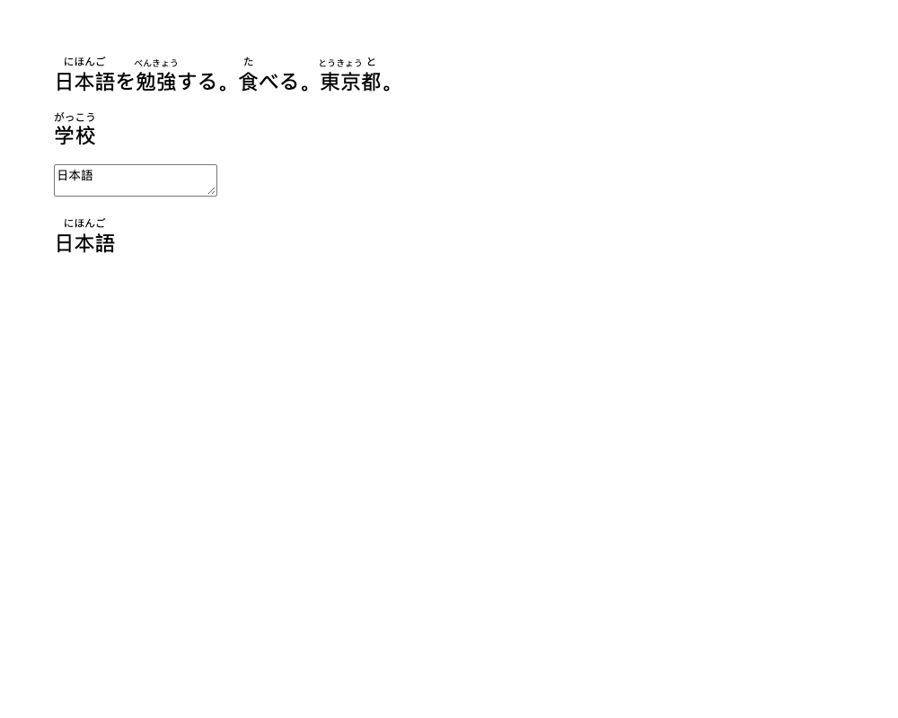
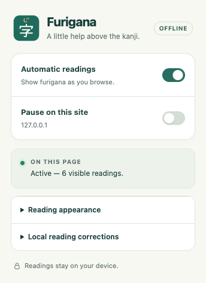
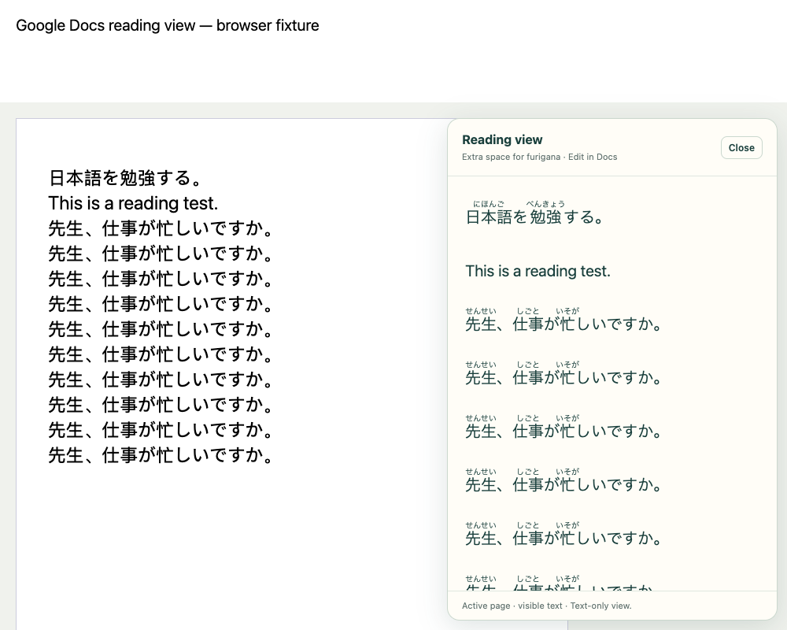

<p align="center"></p>

# Furigana Overlay Browser

**Automatic, offline furigana for Japanese webpages and Google Docs.**

Enable the extension and readings appear as you browse. No “add furigana” button, account, API key, external processing service, or dictionary download. Original webpage text and Google Docs formatting stay unchanged.

The ready-to-load extension is included in **[`dist/`](dist/)**. This project is distributed through GitHub, **not the Chrome Web Store**.

## Screenshots

### Automatic readings on a webpage



### Extension menu



### Extra-space Google Docs reading view



These are screenshots of the actual extension running in a Chromium-based browser. The webpage and Google Docs examples use local test fixtures. The Docs screenshot is **not a live signed-in Google document**; live Docs compatibility remains experimental.

## Install in Chrome — no Web Store required

You do **not** need Node.js, npm, a developer account, or a build step.

1. At the top of this GitHub repository, click **Code → Download ZIP**. If the repository is private, sign in with an account that has access first.
2. **Extract the ZIP** into a folder you will keep, such as `Documents/Furigana`. Chrome loads the extension from this folder, so do not delete or move it afterward.
3. In Chrome, type **`chrome://extensions`** into the address bar and press Enter.
4. Turn on **Developer mode** in the upper-right corner.
5. Click **Load unpacked**.
6. Open the extracted repository folder and select its **`dist` folder**. Select the folder containing `manifest.json`, not the ZIP or the repository's top-level folder.
7. Confirm that **Furigana Overlay Browser** appears and is enabled.
8. Reload existing webpages and Google Docs tabs. Furigana starts automatically. The first page may take a moment while the local dictionary loads.
9. To keep the menu handy, click Chrome's **Extensions** puzzle-piece icon and pin **Furigana Overlay Browser**. Its icon is **字** with **じ** above it.

The folder to select looks like this:

```text
furigana-overlay-browser-<branch>/
├── README.md
├── src/
└── dist/                  ← Select this folder in “Load unpacked”
    ├── manifest.json
    ├── content.js
    ├── background.js
    ├── dict/
    └── icons/
```

Keep Developer mode enabled for this unpacked installation. Managed work or school browsers may restrict loading unpacked extensions; the browser administrator controls that policy. These steps follow [Chrome's official instructions for loading unpacked extensions](https://developer.chrome.com/docs/extensions/get-started/tutorial/hello-world#load-unpacked).

## Use it

- **Automatic readings:** the main switch enables or pauses the extension globally.
- **Pause on this site:** excludes the current hostname without affecting other sites.
- **Reading appearance:** choose Small, Default, Large, or Extra large furigana, and page colors or high contrast. Preferences are saved separately for each hostname.
- **Local reading corrections:** save, edit, or remove readings for names or words. Enter hiragana or katakana; readings display in hiragana. Corrections apply automatically across sites and stay on this device. Up to 200 corrections are supported.
- **Page status:** explains tight spacing, unknown words, unavailable Docs text, and waiting while you scroll or edit.

Overlay readings shrink or are omitted where necessary to preserve the original line spacing. Reading size is a preference, not a guarantee that larger text will fit.

## Google Docs and extra line spacing

The normal overlay processes **only the active page's visible text**. In pageless documents, it processes the editor viewport. It never analyzes every page in a long document.

To give furigana more room:

1. Open a Google Doc and click the extension icon.
2. Expand **Google Docs reading view**.
3. Enable **Extra-space reading view**.
4. Choose **Comfortable**, **Roomy**, or **Spacious** line spacing.

A separate, selectable reading panel appears automatically and follows the active page as you scroll or edit. Continue editing in the original Docs editor. The panel replaces the extension's overlay while active; it does **not** change the document's formatting or line spacing. Click **Close** on the panel, or turn off the option, to restore overlays.

The panel is a **text-only view**. Tables and formatting may be simplified, and images are omitted. The reading-view setting is saved for Google Docs and applies across your documents.

**Docs support is experimental.** It depends on undocumented annotated SVG text geometry supplied by Google's canvas editor. Google can change or omit that surface. The panel and overlays use the same extraction method, so the panel cannot recover text when that geometry is unavailable. Browser tests cover paged and pageless fixtures, editing, IME input, and page switching; they do not guarantee compatibility with every live Google Doc.

## Privacy and permissions

Japanese text is processed locally with bundled Kuromoji/IPADIC dictionaries in an extension worker. There are no external API calls, analytics, accounts, or runtime dictionary downloads.

- The extension needs access to HTTP/HTTPS pages to add readings automatically without a per-page click. You can narrow access using Chrome's extension site-access controls; it will only run on permitted sites.
- It requests local storage for preferences and user-entered corrections, plus an offscreen document for the tokenizer worker.
- Extracted text and dictionary caches stay in memory. Only settings and the corrections you enter are persisted in `chrome.storage.local`.
- It does not request access to your Google account or the Google Docs API.
- The website or Google Docs itself continues using its normal network connection.

Original text nodes, editor values, and document formatting remain unchanged. Overlays ignore mouse input and are hidden during printing. The separate reading panel allows text selection and is also hidden in print.

## Update or uninstall

There are **no automatic Web Store updates**.

To update, download and extract the latest repository ZIP, replace the contents of your existing extension folder with the new version, then click the extension's **Reload** icon on `chrome://extensions`. Reload open webpages and Google Docs tabs too. Keeping the same folder and reloading the existing installation helps retain your local preferences and corrections.

To uninstall, click **Remove** on the extension's card in `chrome://extensions`. You can then delete its local folder.

## Troubleshooting

| Symptom | What to check |
| --- | --- |
| “Manifest file is missing or unreadable” | Extract the ZIP first, then select the `dist` folder containing `manifest.json`. |
| No furigana after installation or an update | Reload the extension and the webpage. Check the main switch, site pause, Chrome site access, and popup status. |
| Some words have no readings | The dictionary may not know the word, or there may be insufficient space. Add a local correction, reduce the reading size, or try the Docs reading view. |
| A name is read incorrectly | Add its preferred reading under **Local reading corrections**. |
| Google Docs text is unavailable | Reload the document. If the status persists, that editor version may not expose compatible text geometry. |
| No readings in a PDF, image, browser settings page, or another canvas app | These surfaces are unsupported. Google Docs has a dedicated experimental adapter. |
| Cannot find **Load unpacked** | Enable Developer mode. If the control is unavailable, check whether your browser is managed. |

Webpage text inside editable controls or existing ruby is skipped. Vertical writing, rotated text, closed shadow roots, and words fragmented across lines are unsupported. Very dense or complex viewports can exceed discovery limits.

## Performance

Work is bounded to visible content. Processing pauses in background tabs, waits for scrolling/editing to settle, and cancels stale queued work. Docs measurements are cached within each scan; collision checks inspect nearby glyphs. Dictionary caches and analysis batches have fixed limits. The reading panel is capped at 16,000 characters / 2,000 runs and 500 reading candidates.

See [technical notes](docs/technical-notes.md) for the architecture, exact budgets, and compatibility details.

## Build and test

Run these commands from the repository root if you want to develop the extension:

```sh
npm ci
npm run build
npm run typecheck
npm test
```

`npm run build` regenerates the included `dist/` folder. Development dependency installation requires internet access; the installed extension works without an external processing service.

The test suite has **20 tests**, including automatic annotations, unchanged source/layout, a 100,000-node webpage, a 100-page Docs fixture, cancellation, IME handling, settings, corrections, and the reading panel. Browser integration tests use a temporary profile and localhost server. They default to Brave's standard macOS executable; set `CHROMIUM_PATH` to an extension-capable Chromium executable elsewhere. Chrome distributions that disable command-line extension loading cannot run these integration tests. Your normal browser profile and Google account are not used.

Screenshots are preserved in [`docs/screenshots/`](docs/screenshots/). Regenerated browser captures are written to `test-results/` during tests.

## Third-party notices

Bundled dependency licenses are included in [`dist/licenses/`](dist/licenses/), including Kuromoji (Apache 2.0), IPADIC's notice, async, doublearray, zlibjs, and lodash. Project code currently has no open-source license grant (`UNLICENSED` in `package.json`).
