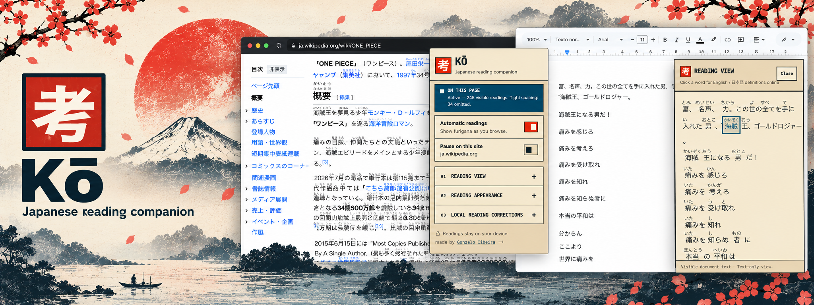
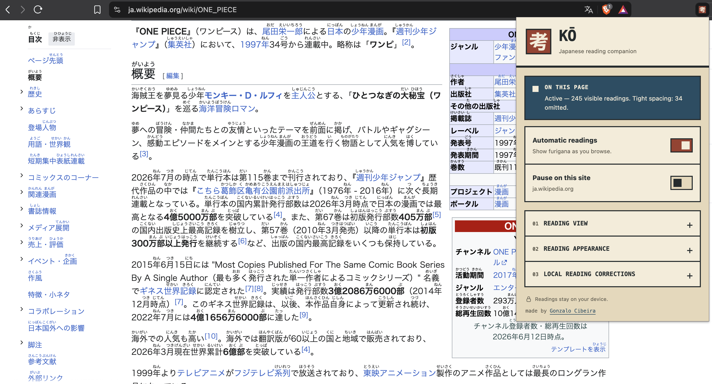
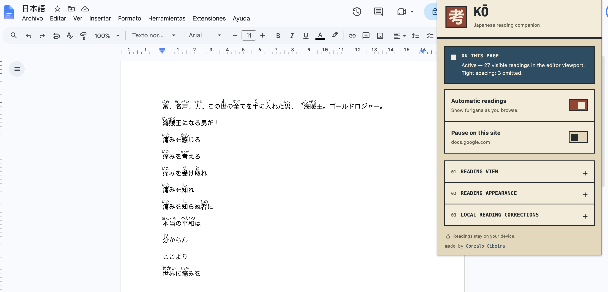
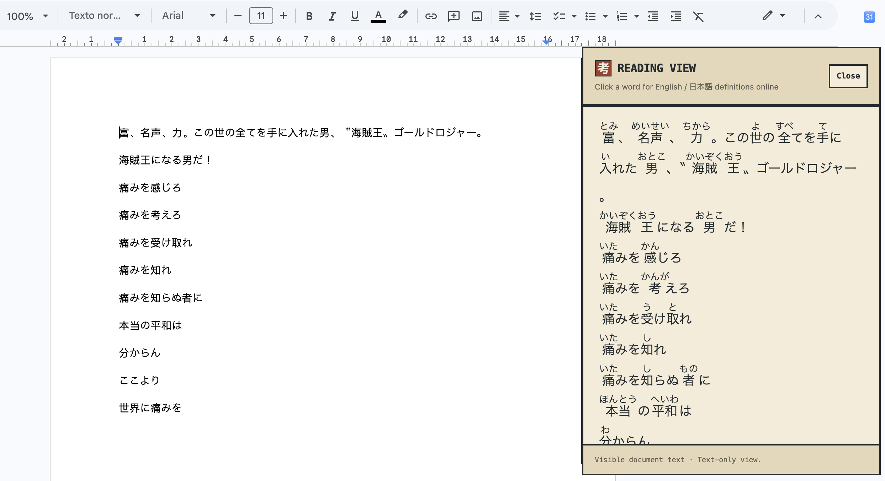
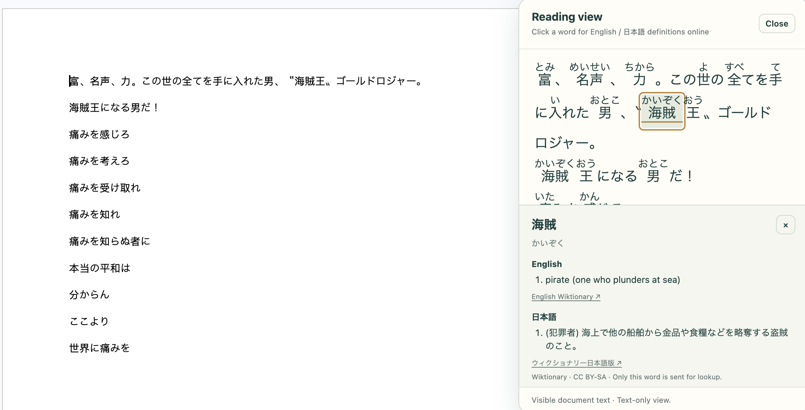

<p align="center">
  
</p>

<h1 align="center">Kō — Japanese Reading Companion</h1>
<p align="center"><strong>Japanese reading companion.</strong></p>
<p align="center">Automatic Japanese readings for webpages and Google Docs.<br>Furigana runs on your device. Optional word definitions use Wiktionary online.</p>
<p align="center">Source candidate <strong>1.1.0</strong> · Published store release <strong>1.0.0</strong></p>
<p align="center">
  <a href="https://chromewebstore.google.com/detail/khhdlbblmannlpbkmhmppakldpjhaiok">Install from the Chrome Web Store</a> ·
  <a href="#see-it-in-action">See it in action</a> ·
  <a href="#make-it-yours">Make it yours</a> ·
  <a href="#help-and-compatibility">Get help</a> ·
  <a href="#release-notes">Release notes</a>
</p>



<p align="center"><em>Read Japanese where you already browse. Readings appear automatically above the kanji.</em></p>

| Read as you browse | Keep your work intact | Stay in control |
| --- | --- | --- |
| Furigana appears automatically on visible Japanese text. | Original webpage text and Google Docs formatting stay unchanged. | Pause a site, adjust the appearance, or save your own readings. |
| **Offline furigana** uses bundled reading dictionaries. | **Reading panel for webpages and Google Docs** adds extra spacing and optional online word definitions. | **No extension account or API key** needed. Settings and corrections are saved on this device. |

## Release notes

### 1.1.0 · Local release candidate

- **Verb Playground.** Choose a form family, including potential, passive, causative, desire, conditionals, requests, commands, and everyday ～て constructions. Applicable Past, Negative, Polite, and Spoken shortening switches update the form, furigana, and highlighted changes. Reset restores the exact original. Ambiguous forms offer explicit choices.
- **Mimetic Playground.** Explore 60 expressions through 30 original illustrated comparisons covering feelings, bodily states, movement, people, texture, sound, light, and weather. Each expression has a Japanese example, translation, reference, and notes about other uses. Replay runs a short animation; reduced-motion settings keep it still.
- **Offline playground workspace.** Enter a dictionary-form verb directly, or click a verb in the reading panel to open its playground. The Mimetic tab lets you search all 60 expressions. No account or connection is needed.
- **Meaning Forks.** Compare common potential/passive/honorific functions of supported ～られる forms, or make/let functions of causatives. Role diagrams explain the possibilities while the original phrase stays visible. Context determines which function fits.
- **Local word details.** Clicking a word opens readings, corrections, and available exploration without a request. Choose **Look up definitions online** to request English and Japanese Wiktionary definitions. Loaded definitions can be redisplayed from memory.

The rebuilt [`dist/`](.) contains this candidate. It has not been uploaded to the Chrome Web Store. No new permissions, runtime services, accounts, API keys, or learning-history storage are introduced. See [exploration notes](docs/exploration-notes.md) for supported forms and linguistic limits.

**About Kō → What’s new** shows the current release notes and links to the full offline history. The build also prepares a [GitHub release draft](docs/github-release-1.1.0.md) from the same [changelog](docs/release-notes.md); it does not create or publish a GitHub release.

Current verification: build and typecheck pass, with 136 of 137 automated checks passing. The native toolbar-popup check is currently blocked by macOS browser-window activation; it passed on the preceding UI candidate, and popup code is unchanged. Integrated UI checks cover 280–720 px panels, short windows, readable switch labels, single-area scrolling, and back navigation. A live smoke check passed on a public, read-only Google Doc; live editing was not exercised. See the [release audit](docs/chrome-web-store-audit.md) for evidence.

### 1.0.0 · 14 October 2026

- **Kō — Japanese Reading Companion.** The new name and vermilion 考 seal share the same identity. The interface uses warm paper, ink, indigo, and vermilion inspired by ukiyo-e prints.
- **Brutalist interface.** Square controls, bold headings, ink borders, and an ukiyo-e-inspired palette across the popup, reading panel, definitions, and corrections.
- **Per-tab 考 icon.** See whether readings are active, paused, or unavailable without opening the menu. Hover over the icon for details.
- **Reading view on webpages and Google Docs.** Enable the panel per website. It follows visible text after scrolling settles, including wrapped webpage paragraphs and kana-only words.
- **Choose your reading size and panel width.** Select 16–32 px text in the popup, or drag the panel’s left edge to resize. Text size, spacing, and width are remembered across sites.
- **Correct readings where you read.** Open a word’s detail card, choose **Correct reading**, and save its preferred pronunciation—even when online definitions fail. Restore the automatic reading from the same form.
- **Find and back up corrections.** Search by word or reading, export a JSON backup, and import it on another installation. Imports keep existing readings when words match and validate the entire backup before saving.

Read the [full release notes](docs/release-notes.md) for details and update instructions. After updating, reload the extension and your open tabs.

## Install in Chrome

**[Install Kō from the Chrome Web Store](https://chromewebstore.google.com/detail/khhdlbblmannlpbkmhmppakldpjhaiok).** Click **Add to Chrome**, confirm the installation, then reload your open tabs to start reading. Store installations receive updates automatically.

**Tip:** Pin **Kō — Japanese Reading Companion** from Chrome's puzzle-piece **Extensions** menu. Look for the warm-paper **考** (think) on a vermilion seal.

### Manual installation

You can also load the ready-to-use extension from [`dist/`](.). No Node.js, npm, or build step needed.

1. **Download the [1.0.0 extension ZIP](https://github.com/gonzalocibeira/ko-japanese-reading-companion/releases/download/v1.0.0/ko-japanese-reading-companion-1.0.0.zip).** It contains the ready-to-load `dist` folder. You can also download the full source from [the repository](https://github.com/gonzalocibeira/ko-japanese-reading-companion) using **Code → Download ZIP**.
2. **Extract and keep the folder.** Put it somewhere permanent, such as `Documents/Ko`.
3. **Open Chrome's extensions page.** Enter `chrome://extensions` in the address bar and turn on **Developer mode**.
4. **Load the extension.** Click **Load unpacked** and select the extracted folder containing `manifest.json`. For a repository/source download, this is the **extension folder**. A `chrome-web-store.zip` package has `manifest.json` directly in its extracted root.
5. **Reload your tabs and read.** Furigana starts automatically. The first page may take a moment while the bundled reading dictionary loads.

<details>
<summary><strong>Which folder should I select?</strong></summary>

```text
ko-japanese-reading-companion-1.0.0/
└── dist/                  ← Select this folder in “Load unpacked”
    ├── manifest.json
    ├── content.js
    ├── background.js
    ├── dict/
    └── icons/
```

Select the extracted folder containing `manifest.json`, not the ZIP or repository root. Keep that folder in place and leave Developer mode enabled. Managed work or school browsers may restrict unpacked extensions.

The diagram shows a repository/source download. When using the locally built `ko-japanese-reading-companion-1.1.0-chrome-web-store.zip` candidate, select the extracted package folder itself. The public 1.0.0 download does not include the new 1.1 playgrounds.

See [Chrome's official instructions for loading unpacked extensions](https://developer.chrome.com/docs/extensions/get-started/tutorial/hello-world#load-unpacked).

</details>

## See it in action

### Interface and toolbar status

The popup and reading panel use square controls, ink borders, warm paper surfaces, indigo, and vermilion accents. All reading settings, corrections, and backups remain available in the expandable sections.

| Toolbar icon | Meaning |
| --- | --- |
| **Vermilion 考** | Readings are enabled and available on this tab, even with no visible kanji. |
| **Sand-colored 考 with pause bars** | Readings are paused globally or for this hostname. |
| **Outlined 考 with a slash** | The page is unavailable, processing failed, or the tab needs a reload. Hover over the icon for the reason. |

Scrolling, typing, and background-tab suspension do not change an otherwise active icon. Click any icon state to open the menu.

### On the web

The Wikipedia example above shows furigana added directly above Japanese text. Open the extension menu to pause a site, customize readings, or check the page status.

### In Google Docs

Readings appear over the visible document text while you keep working in the original editor.



### More room to read

Open the optional **Extra-space reading view** for a separate, selectable panel with roomier spacing. Your document keeps its original layout.



1. Open a webpage or Google Doc and click the extension icon.
2. Expand **Reading view** and enable **Extra-space reading view**.
3. Choose **Comfortable**, **Roomy**, or **Spacious** line spacing and your preferred **Text size**.
4. Drag the panel’s left edge to resize it, or focus the edge with Tab and use the arrow keys.

The panel follows visible webpage text, or the active Docs page, after scrolling or editing settles, keeping the current text visible while an update waits. Unchanged document redraws preserve your selection, reading position, and open definition. Continue editing in Docs; click the panel’s **×** close button to return to overlay readings. Panel activation is saved per hostname. Text size, spacing, and width apply across sites. Existing Google Docs panel preferences are preserved when upgrading.

### Look up a word

Click a word in the reading panel to see its reading and available local tools. Choose **Look up definitions online** for English and Japanese definitions. For inflected words, the card also shows the dictionary form used for lookup. Supported verbs offer **Try verb forms**; words with several tools offer **Open playgrounds** for Verb Playground, Mimetic Playground, or Meaning Forks; these tools require no internet connection.

The **Playgrounds** button opens a full-height workspace without selecting a page word. In **Verbs**, enter a dictionary-form verb such as 書く and confirm its local analysis, or click a verb in the reading panel to open its playground. There is no preset verb list. Use **← Change verb** to return to input. In **Mimetics**, search the sixty expressions by Japanese, reading, or English and filter by category; **← Examples** restores your list position. **← Reading view** returns to your reading position. Experiments and typed verbs remain in memory; the source page is never rewritten. Preview the [verb input](docs/screenshots/playgrounds-verb-input-1.1.png), [Verb Playground](docs/screenshots/playgrounds-verb-1.1.png), and [Mimetic Playground](docs/screenshots/playgrounds-mimetic-1.1.png) layouts.



Here, **海賊** has the reading **かいぞく** and the meaning **pirate**, with definitions in both languages below the reading text. In 1.1, choose the online lookup button to load those definitions. The original Google Doc stays visible beside the panel. Follow either Wiktionary source link to read the full entry.

Definitions come from the English and Japanese editions of Wiktionary and require an internet connection. Only choosing the online lookup button sends the selected word's dictionary form; opening word details or local playgrounds makes no request. Each language shows its own unavailable or missing-entry message when necessary. Failed lookups offer **Retry definitions online**.

You can also focus a word with Tab and open it with Enter or Space. Exploration switches, comparison buttons, and Replay work with the keyboard. Press Escape or the word card's **×** button to dismiss it and return to reading.

These screenshots show Kō 1.0 in use on Japanese Wikipedia and in Google Docs. The reading panel is text-only: tables and formatting may be simplified, and images are omitted.

## Make it yours

| In the extension menu | What you can do |
| --- | --- |
| **Automatic readings** | Turn readings on or pause them everywhere. |
| **Pause on this site** | Pause the current hostname while keeping other sites active. |
| **Reading appearance** | Choose Small, Default, Large, or Extra large readings, with page colors or high contrast. Preferences are saved per hostname. |
| **Reading view** | Open a panel for this website, choose line spacing and text size, and drag its left edge to resize. |
| **Local reading corrections** | Save, search, edit, remove, export, or import preferred readings. Up to 200 corrections apply across sites. |
| **On this page** | Check reading status, including tight spacing or unavailable Docs text. |

To correct a reading directly, click a kanji word in the panel and choose **Correct reading**. The word and current reading are filled in; both can be edited. A saved correction offers **Restore automatic reading**. Corrections work offline even if word definitions cannot load.

Under **Local reading corrections**, search by word or hiragana/katakana reading. **Export backup** downloads only your corrections as JSON; **Import backup** merges a version 1 backup, keeping existing readings on conflicts. Invalid backups or imports exceeding 200 corrections make no changes.

For isolated vocabulary and translation lines such as `出口 = salida`, readings prefer a matching common-noun dictionary entry when the tokenizer selects a proper name. Saved corrections take priority; add one when you intend a standalone surname or another preferred reading.

Readings shrink or are omitted when space is tight to preserve the original line spacing. Try a smaller reading size or the extra-space reading panel when you need more room.

## Privacy and online lookups

Open **About Kō** from the popup or Chrome’s extension options for the project summary, privacy policy, and GitHub links. Reading settings remain in the toolbar popup. Read the dedicated [privacy policy](docs/privacy-policy.md), also available from the extension popup. See the [Chrome Web Store submission audit](docs/chrome-web-store-audit.md) for permission explanations and release steps.

**Furigana readings run on your device.** The extension uses bundled Kuromoji/IPADIC reading dictionaries and sends no text to an external service to generate furigana.

**Word definitions use Wiktionary online.** Choosing **Look up definitions online** sends that word's dictionary form to the English and Japanese Wiktionary services. Wiktionary receives the lookup word and normal connection information, including your IP address. The extension does not send the surrounding sentence or full document. Lookups require an internet connection; cached definitions stay in extension memory. Furigana and all exploration tools run locally, and experiments are not saved.

The extension has no analytics or account requirement. It saves only your settings and reading corrections to local storage.

<details>
<summary><strong>Permissions and local storage explained</strong></summary>

Japanese readings are processed locally with bundled Kuromoji/IPADIC dictionaries in an extension worker. No runtime dictionary download is needed for readings. The explicit online lookup button requests definitions from `en.wiktionary.org` and `ja.wiktionary.org`, without credentials or a referrer. Definitions are cached in memory for up to 100 words per panel and are not saved to local storage. Wiktionary receives the requested word and the normal connection information, including your IP address. Exploration uses bundled code and original artwork; it makes no requests and saves no history.

- The extension needs access to HTTP/HTTPS pages to add readings automatically without a per-page click. You can narrow access using Chrome's extension site-access controls; it will only run on permitted sites.
- It requests local storage for preferences and user-entered corrections, plus an offscreen document for the tokenizer worker.
- Extracted text, reading caches, and definition caches stay in extension memory. Only settings and the corrections you enter are persisted in `chrome.storage.local`.
- It does not request access to your Google account or the Google Docs API.
- The website or Google Docs itself continues using its normal network connection.

Original text nodes, editor values, and document formatting remain unchanged. Overlays ignore mouse input and are hidden during printing. The separate reading panel allows text selection and is also hidden in print.

</details>

## Help and compatibility

<details>
<summary><strong>Missing readings, incorrect names, or installation trouble?</strong></summary>

| Symptom | What to check |
| --- | --- |
| “Manifest file is missing or unreadable” | Extract the ZIP first, then select the folder containing `manifest.json`: `dist` for source downloads, or the extracted root of a store package. |
| “Extension context invalidated” after an update or extension reload | Reload the affected webpage or Google Docs tab so it uses the current content script. |
| No furigana after installation or an update | Reload the extension and the webpage. Check the main switch, site pause, Chrome site access, and popup status. |
| Some words have no readings | The dictionary may not know the word, or there may be insufficient space. Add a local correction, reduce the reading size, or try the reading view. |
| A name is read incorrectly | Add its preferred reading under **Local reading corrections**. |
| Google Docs text is unavailable | Reload the document. If the status persists, that editor version may not expose compatible text geometry. |
| No readings in a PDF, image, browser settings page, or another canvas app | These surfaces are unsupported. Google Docs has a dedicated text adapter. |
| Cannot find **Load unpacked** | Enable Developer mode. If the control is unavailable, check whether your browser is managed. |

Webpage text inside editable controls or existing ruby is skipped. Vertical writing, rotated text, and closed shadow roots are unsupported. Overlay readings skip words fragmented across lines; the reading panel can reflow wrapped webpage text. The panel reads the top-level page, without combining embedded-frame text. Very dense or complex viewports can exceed discovery limits.

</details>

<details>
<summary><strong>How Google Docs support works</strong></summary>

The overlay processes only the active page's visible text, or the editor viewport in pageless documents. It does not analyze every page in a long document. The reading panel replaces overlays while active and does not change document formatting or line spacing.

Docs support depends on undocumented annotated SVG text geometry supplied by Google's canvas editor. Google can change or omit that surface. The reading panel and overlays use the same extraction method, so the panel cannot recover text when that geometry is unavailable.

Browser tests cover paged and pageless fixtures, editing, IME input, and page switching; they do not guarantee compatibility with every live Google Doc.

</details>

<details>
<summary><strong>Update or uninstall</strong></summary>

**Chrome Web Store installation:** Chrome updates Kō automatically when a new release is available. After an update, reload open webpages and Google Docs tabs.

**Manual installation:** Download and extract the latest repository ZIP, replace the contents of your existing extension folder, then click the extension's **Reload** icon on `chrome://extensions`. Reload open webpages and Google Docs tabs too. Keeping the same folder and reloading the existing installation helps retain preferences and corrections.

**To uninstall:** Click **Remove** on the extension's card in `chrome://extensions`. If you installed manually, you can then delete its local folder.

</details>

## Why I built this

I couldn't find a good option for adding furigana in Google Docs. I wanted readings to appear automatically, work offline, and leave the original document unchanged. That grew into this extension: a little help while browsing, with extra room to read when you need it. The reading panel works on webpages and also offers optional online word definitions from Wiktionary.

## For developers

<details>
<summary><strong>Build and test</strong></summary>

Run these commands from the repository root if you want to develop the extension:

```sh
npm ci
npm run build
npm run typecheck
npm test
```

`npm run build` regenerates the included `dist/` folder. Development dependency installation requires internet access. Furigana readings require no external service; optional word definitions contact Wiktionary and require an internet connection.

The test suite covers automatic annotations, unchanged source/layout, a 100,000-node webpage, a 100-page Docs fixture, cancellation, IME handling, settings, corrections, vocabulary/name disambiguation, local exploration and real-dictionary form round trips, keyboard and reduced-motion behavior, the reading panel, debounced refreshes, explicit bilingual word definitions, toolbar state and lifecycle, and expanded popup forms. Browser integration tests use a temporary profile and localhost server. The native toolbar-popup regression opens a temporary visible browser window to verify Chrome’s popup sizing and wheel scrolling. They default to Brave's standard macOS executable; set `CHROMIUM_PATH` to an extension-capable Chromium executable elsewhere. Chrome distributions that disable command-line extension loading cannot run these integration tests. Your normal browser profile and Google account are not used.

The four inline 1.0 screenshots supplied by the project owner cover webpage overlays, Google Docs overlays, the reading panel, and bilingual word definitions. Linked 1.1 playground previews were captured during a live public read-only Google Docs smoke test. Earlier fixture captures remain in [`docs/screenshots/`](docs/screenshots/). Regenerated browser captures are written to `test-results/` during tests.

</details>

<details>
<summary><strong>Performance and architecture</strong></summary>

Furigana work is bounded to visible content. Reading analysis pauses in background tabs, waits for scrolling/editing to settle, and cancels stale queued work. Docs measurements are cached within each scan; collision checks inspect nearby glyphs. Reading caches and analysis batches have fixed limits. The reading panel is capped at 16,000 characters / 2,000 runs and 500 reading candidates. Typed verbs use a separate bounded local analysis channel. Only **Look up definitions online** sends a definition request; up to 100 lookup results are cached in panel memory.

See [technical notes](docs/technical-notes.md) for the architecture, exact budgets, and compatibility details.

</details>

## License

Project code is licensed under the [MIT License](LICENSE). You can use, modify, and redistribute it under those terms.

### Third-party notices

Bundled dependency licenses are included in [`dist/licenses/`](licenses/), including Kuromoji (Apache 2.0), IPADIC's notice, async, doublearray, zlibjs, lodash, and kamiya-codec (Unlicense). These dependencies retain their own licenses; the project MIT license does not replace them.
